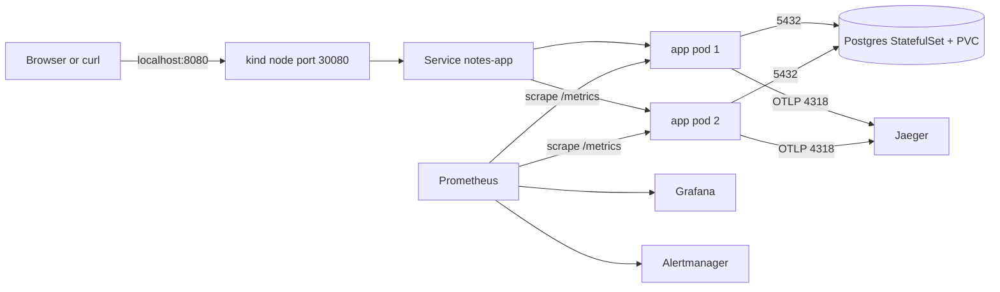

# Design decisions

This document explains how the system fits together, why each choice suits this app, and what changes under different requirements.

## Architecture

There are three components in the `notes` namespace and one platform namespace.

| Component | Workload | Why |
|---|---|---|
| Flask app (gunicorn) | Deployment, 2 to 5 replicas, HPA | Stateless. Any pod can serve any request, so replicas are interchangeable. |
| Postgres 17 | StatefulSet, 1 replica, 1 Gi PVC | Needs stable identity and its own volume that survives pod restarts. |
| Jaeger 2 all-in-one | Deployment, 1 replica | Receives OTLP traces and has a UI. In-memory storage is acceptable for local use. |
| kube-prometheus-stack | Helm release in `monitoring` | Prometheus, Grafana, and Alertmanager. The Prometheus Operator reads the ServiceMonitor and PrometheusRule that the app chart ships. |
| metrics-server | Helm release in `kube-system` | Gives the HPA CPU usage. |

### Request path

1. A user sends a request to `localhost:8080`. The kind configuration maps that port to node port 30080.
2. kube-proxy forwards the request to the `notes-app` Service, which picks a ready app pod. Pods that fail `/readyz` are not in the Service endpoints.
3. The NetworkPolicy lets traffic reach the pod on port 8080.
4. gunicorn gives the request to Flask. The Flask OpenTelemetry instrumentation starts a span. The psycopg instrumentation adds a child span for each SQL query.
5. The app opens a connection to `notes-postgres:5432`. A NetworkPolicy lets only app pods connect to Postgres.
6. The response goes back. The `after_request` hook counts the request in `http_requests_total`, records the latency in a histogram, and writes one JSON log line with the `trace_id`.

### Commit to running app

1. You push a commit to the PR branch.
2. GitHub Actions runs two jobs in parallel. The `test` job runs ruff with bandit rules, pytest against a real Postgres, and pip-audit. The `security` job runs gitleaks over the full history and a Trivy misconfiguration scan of the Dockerfile and the rendered Helm chart.
3. `build-and-deploy-test` builds one multi-arch image (amd64 and arm64). The tag is the full commit SHA, and the SHA is also baked into the image as `APP_VERSION`. It pushes the image to GHCR and runs Grype as a vulnerability gate. Then it creates a kind cluster and installs the chart with that image under the restricted Pod Security Standard. It runs `helm test` and makes sure that `/version` returns the same SHA.
4. `release` waits for manual approval on the `release` environment. After approval, it points `:stable` at the tested digest. There is no rebuild, so the released bytes are the tested bytes.
5. On the laptop, `./deploy.sh <sha>` pulls that image and performs a Helm rolling upgrade on the local kind cluster. Then it runs `helm test` and prints the running version.

GitHub cannot reach a cluster on a laptop, so the last step is a manual pull. In the cloud, the same step becomes a job in the `release` environment, or Argo CD that watches the chart.

## Decisions and alternatives

### Kubernetes

- Deployment for the app, StatefulSet for Postgres. The app holds no state. Postgres needs a stable network name and a volume that follows it. For production, I will replace the StatefulSet with a managed database (Cloud SQL, RDS), because a single Postgres pod has no failover.
- Separate liveness and readiness. `/healthz` checks only that the process answers, so a database outage does not restart every app pod (a restart cannot fix the database). `/readyz` checks Postgres and creates the missing schema. A pod gets traffic only after `/readyz` passes. An earlier version created the schema with a startup retry loop. That loop gave up after 60 seconds while Postgres DNS was not yet resolvable, and the app then served 500 errors. Moving the step into readiness fixed it, because the kubelet keeps probing.
- Resources. Requests (50m CPU, 128 Mi) let the scheduler place pods and give the HPA a baseline. The memory limit (256 Mi) stops a leak from starving the node. The CPU limit is 500m, which is enough for gunicorn with 8 threads.
- Scaling. The HPA scales from 2 to 5 pods at 70% CPU. Two pods minimum plus a PodDisruptionBudget (`minAvailable: 1`) keep the app up during node drains and rollouts. With more nodes, I will add a topology spread constraint to put replicas on different nodes. kind here has one node, so the constraint has no effect.
- Graceful shutdown. A 5 second `preStop` sleep lets the endpoint removal propagate before gunicorn gets SIGTERM. Then gunicorn finishes in-flight requests within 20 seconds.
- Exposure. The app uses a NodePort mapped to localhost. In 2026 the community ingress-nginx project is retired, and an Ingress or Gateway adds a controller for no benefit on one local host. In the cloud, a Gateway API implementation with TLS replaces the NodePort.

### Configuration

- One Helm chart holds everything the app needs (app, database, tracing, policies, monitoring objects). `values.yaml` is the single source. Environment differences are `--set` flags: CI turns off the HPA and monitoring CRDs, and local turns on monitoring. There are no copied manifest folders per environment, so they cannot drift.
- `image.tag` is required. If it is empty, the chart fails. Nobody can deploy `latest` by accident. Every running pod shows its commit in four places: the image tag, the `app.kubernetes.io/version` label, `/version`, and the `notes_build_info` metric.
- `deploy.sh` is idempotent (safe to run twice). Existing objects (the cluster, the platform add-ons, the namespace, the secret) stay unchanged. Then it performs a Helm upgrade. A second run with the same SHA changes nothing. Kustomize was the alternative. Helm was chosen because it adds release history, which gives rollback and `helm test`.

### CI/CD and release control

- GitHub Actions, because the code is on GitHub and the free hosted runners can run kind. Jenkins or GitLab CI can do the same work but need a server.
- Build once, promote by digest. The image that passed the deploy test is the one that is released. A rebuild at release time can pull different base layers.
- The approval gate is on promotion, not on tests. Checks are cheap and automatic. Releasing is the decision a human makes.
- Rolling update with `maxUnavailable: 0` and `maxSurge: 1`. A new pod must pass readiness before an old pod is removed. If the new pods do not become ready in 4 minutes, `helm upgrade --rollback-on-failure` reverts automatically. A known-good version can be redeployed at any time with `./deploy.sh <old-sha>` or `helm rollback notes <revision>`.
- Canary or blue-green were not chosen. They need traffic splitting (a service mesh or Gateway) and enough traffic to compare error rates. A personal notes app has neither. With real users, I will add Argo Rollouts with an analysis step that queries `notes:error_ratio:rate5m`.
- Drift. Helm owns every object in the namespace, and `helm diff`/`helm get manifest` shows what is live. The only out-of-band object is the DB secret, on purpose. If more than one person deploys, the next step is Argo CD with self-heal.

### Observability

- Metrics. The app has request count by route and status, a latency histogram, and a build-info gauge. Route labels use the Flask rule (`/api/notes/<int:nid>`), not the raw path, so label cardinality stays bounded.
- SLOs. The targets are a 99% success rate (non-5xx) on user routes and p95 latency under 300 ms. The alerts are in `chart/notes/templates/monitoring.yaml`, and each alert links to a runbook section.
- Logs. The app writes one JSON line per request with `trace_id`, version, route, status, and duration. You read them with `kubectl logs`. The `trace_id` lets you jump from a log line to the Jaeger trace. A log store (Loki) was left out to save laptop memory. It is the first addition for multi-node use.
- Traces. OpenTelemetry sends spans over OTLP/HTTP to Jaeger. The probes are excluded, so traces show real user requests only.
- Prometheus scrapes 2 app pods every 15 seconds. The Grafana dashboard "Notes app" shows rate, error ratio, p95, running version per pod, ready pods, and restarts.

### Security

| Area | Control |
|---|---|
| Secrets | The DB password is random, generated on first deploy, and stored only in a Kubernetes Secret. It is never in git, values files, or CI logs. CI generates its own throwaway secret. gitleaks scans the full history on every run. |
| Pod runtime | The namespace enforces the restricted Pod Security Standard. All pods run as non-root with a read-only root filesystem, no privilege escalation, all capabilities dropped, and the RuntimeDefault seccomp profile. pip is removed from the image. |
| Permissions | The app ServiceAccount has no RBAC bindings, and its token is not mounted. CI jobs default to `contents: read`. Only the build and release jobs get `packages: write`. |
| Network | Default-deny NetworkPolicy for ingress and egress. App to Postgres, app to Jaeger, and DNS are the only allowed paths. Postgres has no Service outside the namespace and no node port. |
| Exposure | Only the app is exposed on the host. Grafana, Prometheus, and Jaeger are reachable only through `kubectl port-forward`. |
| Supply chain | Pinned Python dependencies, pip-audit, Grype image gate, Trivy configuration scan, and Dependabot for pip, Docker, and Actions. Scanners run from pinned images, not marketplace actions. |
| App | Input length limit, HTML escaping, an Origin check on the HTML form as CSRF protection, and parameterized SQL. |

## Changed conditions

| Changed requirement or failure | Effect and response |
|---|---|
| Postgres pod dies | Readiness fails on all app pods, so the Service has no endpoints and users get connection errors. `NotesNoReadyPods` fires. The StatefulSet restarts the pod on the same PVC, so no data is lost. Readiness recovers without app restarts. This was tested, see `docs/EVIDENCE.md`. |
| Node or PVC loss | Data is lost. There are no backups. Next step: a `pg_dump` CronJob to object storage, or a managed database. |
| 10 times more traffic | The HPA adds app pods. Postgres becomes the limit: add connection pooling (PgBouncer) before replicas. |
| Bad release (pods never ready) | `--rollback-on-failure` returns to the previous revision. Users see no errors, because old pods stay until new pods are ready. This was tested, see `docs/EVIDENCE.md`. |
| Bad release that is ready but returns errors | Readiness passes, so the rollout completes. `NotesHighErrorRate` fires within about 2 minutes. You respond with `./deploy.sh <previous-sha>`. A canary with automated analysis catches this before full rollout. |
| Multiple environments | Add `values-staging.yaml` and `values-prod.yaml` with only the differences, and one `release` job per environment with its own approval. |
